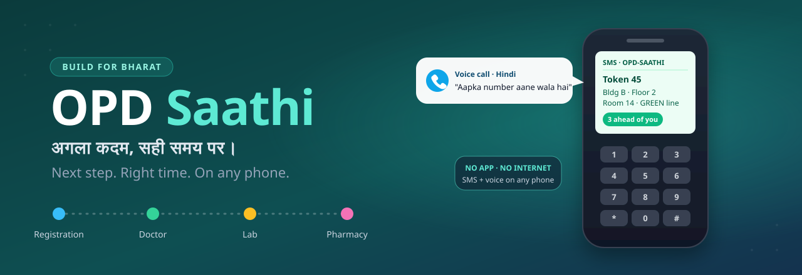
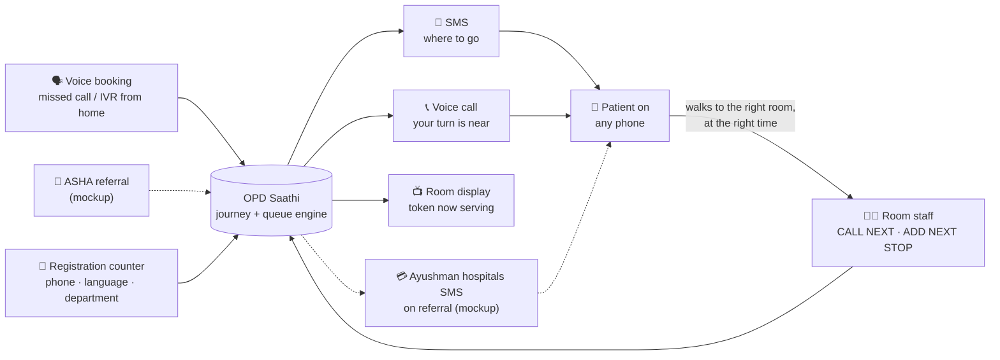
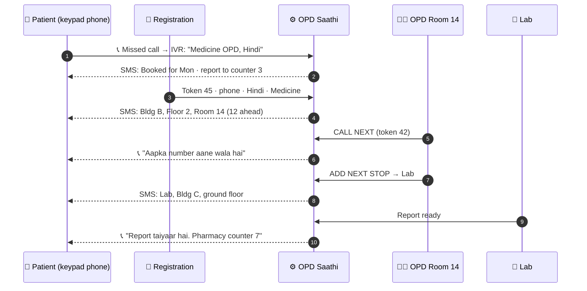

<div align="center">



<br/>

### Every day, thousands of patients get a token at India's biggest hospitals, and then get lost.<br/>OPD Saathi tells them **where to go next** and **when their turn is coming**, on the phone already in their pocket.

<br/>

<a href="#-the-problem"></a>
<a href="#-what-opd-saathi-does"></a>
<a href="#-roadmap"></a>

<sub>Built for the <b>Build for Bharat</b> hackathon · Problem T2P3: <i>Patient Navigation for Public Hospitals</i></sub>

<br/>

[The problem](#-the-problem) · [The idea](#-the-idea-in-one-line) · [How it works](#-how-it-works) · [Why it's different](#-why-not-just-use-an-app) · [The bigger picture](#-the-bigger-picture) · [Roadmap](#-roadmap)

</div>

---

## 🧭 The problem

> *A son brings his mother from a village in Bihar to a big government hospital in Delhi. Registration takes minutes. Then he asks a guard where the doctor sits, waits by a crowded door without knowing when his number will be called, steps away for water, and misses his turn. The doctor orders a blood test, and he starts over. By evening they're sleeping outside the hospital, to come back tomorrow.*
>
> <sub>An illustrative scene. Every number below is real and sourced.</sub>

<table>
<tr>
<td align="center" width="25%"><h2>~15,000</h2><sub>OPD patients <b>every day</b> at AIIMS Delhi alone<br/><a href="https://www.freepressjournal.in/india/15000-patients-1000-surgeries-5-year-waits-the-complex-world-of-aiims-delhi">FPJ, 2026</a></sub></td>
<td align="center" width="25%"><h2>59%</h2><sub>of AIIMS patients come from <b>outside Delhi</b><br/><a href="https://www.thequint.com/my-report/photos-surviving-on-langars-living-in-tent-life-of-patients-outside-aiims">AIIMS data, Jan 2024</a></sub></td>
<td align="center" width="25%"><h2>69.6%</h2><sub>of first-time OPD visitors <b>needed a person</b> to find their way<br/><a href="https://www.ijcmph.com/index.php/ijcmph/article/view/15904">IJCMPH, 2026</a></sub></td>
<td align="center" width="25%"><h2>~2 hrs</h2><sub>spent in OPD for <b>~3 minutes</b> with the doctor<br/><a href="https://arxiv.org/pdf/2604.00215">studies cited in arXiv, 2026</a></sub></td>
</tr>
</table>

India has already sped up **registration**. With ABHA Scan & Share, the registration wait fell from 30–40 minutes to 5–10 ([MoHFW, 2024](https://www.mohfw.gov.in/press-info/7908)).

**Everything after the registration slip is still guesswork:** which building, which floor, which line, how long, what next. Each missed turn can mean another day away from home. For a patient and one attendant on daily wages, that's about **₹1,420 lost** (2 × ₹710, Delhi's unskilled minimum wage), before counting travel, food or a night on the pavement.

---

## 💡 The idea in one line

<div align="center">

### Registration gave patients a token. OPD Saathi gives that token a voice.

</div>

When staff call a token or order a test, the patient's phone gets an **SMS** and a **voice call in their own language** telling them exactly where to go and when.

No app. No internet. No smartphone. Just the keypad phone that **~250–300 million Indians** still carry ([TelecomTalk, 2025](https://telecomtalk.info/?p=1002728)).

---

## ✨ What OPD Saathi does

<table>
<tr>
<td width="33%" valign="top">

### 🎫 1. Journey starts at the counter
The clerk enters the patient's phone number, language and department. Within a minute, an SMS arrives:

```
Token 45 · Medicine OPD
Bldg B, Floor 2, Room 14
Follow the GREEN line
12 people ahead of you
```

</td>
<td width="33%" valign="top">

### 👆 2. One tap for staff
Each OPD room gets one big button on a cheap tablet:

**`CALL NEXT`** &nbsp;·&nbsp; **`ADD NEXT STOP`**

Pressing it replaces shouting numbers into a crowd. It also moves the patient's journey forward on its own: Lab → Reports → Pharmacy.

</td>
<td width="33%" valign="top">

### 📞 3. "Your turn is near"
When 3 tokens are left, the phone **rings**:

> *"Aapka number aane wala hai. Room 14 par aaiye."*

They can step away for water, food or the toilet without fear of losing their place. If they can't read, they can still listen.

</td>
</tr>
</table>

### 🧩 The full journey: from booking at home to the last counter

OPD Saathi is one **voice-first** journey. Each module below hands off to the next.

| | Module | What it does for the patient | Hackathon build |
|:---:|---|---|:---:|
| 🗣️ | **Multilingual voice assistant** | Book an OPD visit by **missed call or IVR** in Hindi, Bhojpuri and more, then track the appointment by SMS and voice call, all on a keypad phone | ✅ Build |
| 🧑‍⚕️ | **Patient & queue management** | Registration screen plus a one-tap room screen. Every tap moves the journey forward and triggers the next message | ✅ Build |
| 🤝 | **ASHA referral link** | A village ASHA worker refers and pre-books a patient, so the hospital knows they're coming | 🧪 Mockup |
| 💳 | **Ayushman card hospitals** | When a doctor refers a patient for admission or surgery, an SMS lists nearby hospitals that accept the Ayushman card, plus the Ayushman desk location | 🧪 Mockup |

> [!IMPORTANT]
> **Privacy by design.** OPD Saathi stores **journey data only**: token, phone, language and stops. It stores **no medical records**. Anything clinical goes through ABHA and ABDM's consent-based exchange, in line with India's DPDP Act and Rules.

---

## ⚙️ How it works



<details>
<summary><b>One patient, start to finish (sequence)</b></summary>

<br/>



</details>

**When things go wrong (and they will):**

| If… | OPD Saathi… |
|---|---|
| The phone number was typed wrong | Sees no delivery receipt within 2 min and flashes *"check number / give printed slip"* on the clerk's screen |
| The patient misses the call | Marks the token *missed*, puts them back after the next patient, and sends *"Come to Room 14, you're next"* |
| The patient has no phone at all | The printed slip carries the same token, room and colour line |

---

## 🥊 Why not just use an app?

AIIMS Delhi already has a good navigation app, **[AIIMS Disha](https://www.tribuneindia.com/news/delhi/aiims-launches-disha-navigation-app-to-assist-patients-visitors/amp)** (2025). We built OPD Saathi to work **alongside** it, not to compete with it.

| | Ask a guard / signs | AIIMS Disha | ABHA Scan & Share | **OPD Saathi** |
|---|:---:|:---:|:---:|:---:|
| **Book a visit** by phone call | ❌ | ❌ | ❌ registration only | ✅ missed call / IVR |
| Answers *"where is the lab?"* | 🟡 if you find someone | ✅ | ❌ | ✅ by SMS |
| Answers *"when is my turn?"* | ❌ | ❌ not in launch reports | ❌ | ✅ |
| Answers *"what do I do next?"* | 🟡 | ❌ | ❌ | ✅ |
| Works on a **keypad phone** | ✅ | ❌ smartphone + install | 🟡 smartphone QR | ✅ |
| Works if you **can't read** | ✅ | 🟡 voice in app | ❌ | ✅ voice call |
| Needs hardware in the building | — | Bluetooth beacons | QR posters | **A tablet per room** |

<div align="center">

**Disha tells you *where*. OPD Saathi tells you *what's next, and when*, on any phone.**

</div>

---

## 🌏 The bigger picture

AIIMS Delhi is where the problem is worst, but it isn't the only place it happens.

- 🏥 **New AIIMS hospitals** recorded **1.45 crore OPD consultations** in 2025–26 alone ([DD News, 2026](https://ddnews.gov.in/en/new-aiims-record-over-6-crore-opd-consultations-expanding-access-to-specialised-healthcare/)).
- 🧾 **17,000+ facilities** already issue digital OPD tokens through ABHA Scan & Share ([MoHFW, 2024](https://www.mohfw.gov.in/press-info/7908)). Every one of those tokens could get a voice.
- 📱 Hospitals **already collect phone numbers**. Safdarjung had valid numbers for 69% of visits in one OPD in 2024 ([Mera Aspataal](https://vmmc-sjh.mohfw.gov.in/sites/default/files/2024.pdf)).
- 💸 An SMS costs about **₹0.18** at volume ([Exotel](https://exotel.com/?p=1809)). A whole visit's worth of guidance costs **under ₹1**.

No beacons, no app store and no new habit for patients are needed. If one hospital can run it on one tablet per room, **every district hospital in India can too.** That's the future we're building towards: no patient in India loses a day because nobody told them where to go next.

---

## 🛠️ Roadmap

> [!NOTE]
> **Honest status:** we picked this problem on 23 Nov 2026. This repo is where the build happens, and everything below is being built now.

**Phase 1: hackathon build**
- [ ] Voice booking by missed call / IVR in Hindi (hospital booking API simulated)
- [ ] Journey + queue data model (patients, stops, rooms, tokens)
- [ ] Registration screen for clerks
- [ ] One-tap room screen: `CALL NEXT` · `ADD NEXT STOP`
- [ ] SMS in Hindi (then Bhojpuri, Bengali)
- [ ] Turn-near voice call, with a simulated fallback for the live demo
- [ ] Missed-turn and failed-delivery recovery
- [ ] Demo seed data modelled on a real hospital layout
- [ ] Clickable mockups: ASHA referral screen · Ayushman hospital SMS
- [x] Demo video (concept)

**Phase 2: after the hackathon**
- [ ] ASHA referral link: ASHA workers pre-book and refer through the same voice flow
- [ ] Ayushman card: live list of empanelled hospitals from official PM-JAY data, sent at referral time
- [ ] ABHA / ABDM consent-based linking for clinical records (we never store them ourselves)
- [ ] Bhojpuri, Bengali, Tamil and more voice prompts, recorded by native speakers

**Deliberately out of scope:** indoor maps and turn-by-turn directions. Disha already does that, and a text like *"Room 14, follow the GREEN line"* plus the hospital's own floor signs gets patients there.

---

## 🔬 What we still need to prove

Our biggest assumption is that **OPD staff will tap `CALL NEXT` every time.** If they don't, every alert is wrong.

**How we'll test it:** shadow one real OPD room for a session with a paper "NEXT" tick card. We need at least 8 out of 10 calls ticked without a reminder. If staff fall short, we'll hook the button into the token display they already press.

📄 Full research, sources and assumptions: [`docs/problem-brief.md`](docs/problem-brief.md)

---

<div align="center">

### 🤝 Built by

**[Abhishek Goswami](https://www.linkedin.com/in/abhishekgoswami0720/)** · B.Tech CSE (AI/ML), GLA University · Founder, Let's Cook

<sub>Have you ever been lost in a government hospital? Open an issue and tell us what happened. Real stories shape what we build.</sub>

<br/><br/>

<b>अगला कदम, सही समय पर।</b><br/>
<sub>Next step. Right time. On any phone.</sub>

</div>
